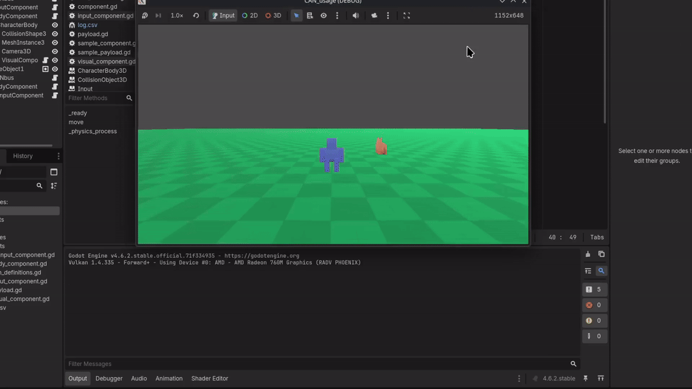
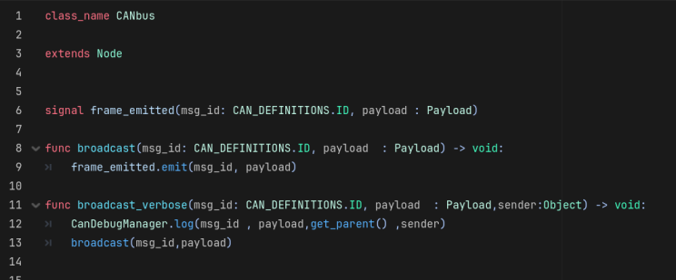
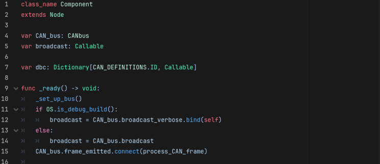
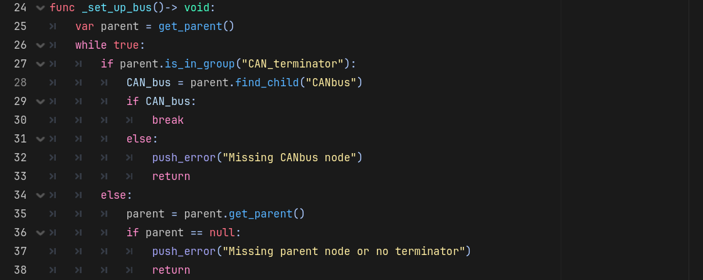
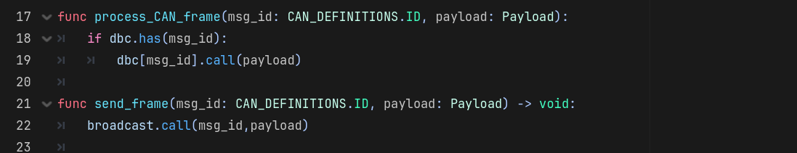
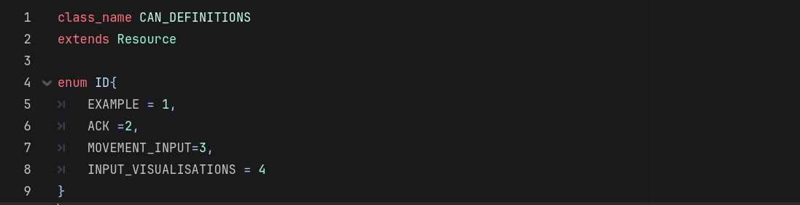
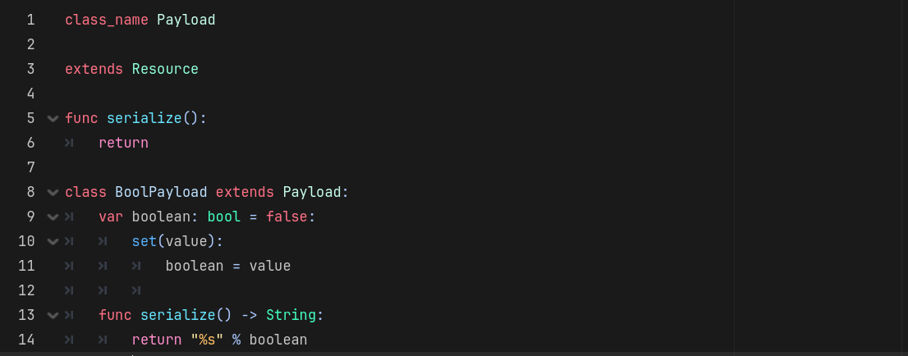
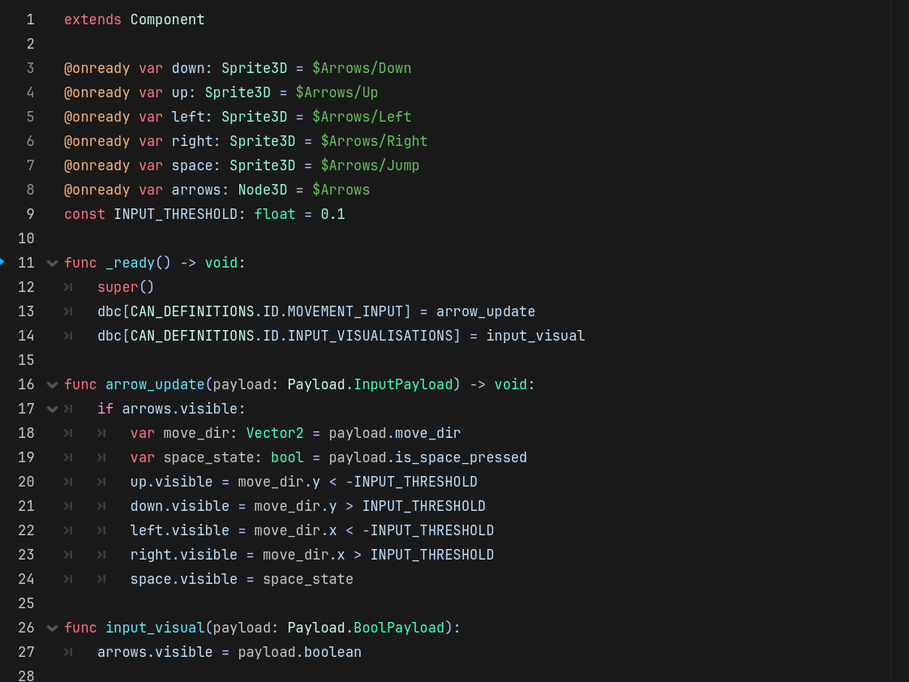

The code for this project has been sitting on my drive for almost 2 months. It's time to dust off the CAN bus idea.

Every game object we want to add functionality to needs a `CANbus` child node and has to be in the `CAN_terminator` group. The `broadcast` method simply passes the frames to all the components on the bus using Godot's built-in signals. `broadcast_verbose` does the same thing, except it first sends the frames to `CanDebugManager`. `CanDebugManager` is a simple autoload. That means Godot loads it when the game starts and it's available from everywhere, kind of like a global variable in other languages. Its only purpose is to log the frames to a file and display them in the terminal (you can see it in action in the GIF above).



```
20:06:05 ; 369028 ; GameObject1:<Node3D#41573942787> ; AiInputComponent:<Node#41842378259> ; MOVEMENT_INPUT ; 0.70710676908493 -0.70710676908493 false
20:06:06 ; 1014722 ; PlayerObject:<Node3D#41104180701> ; InputComponent:<Node#41137735137> ; MOVEMENT_INPUT ; 1.0 0.0 false
```

Output seen in the log file.

Now let's get to the heart of the project. `Component` is the base class for every CAN component we'll build. Godot calls `_ready()` once, after a node and all of its children have entered the scene tree. Let's ignore `_set_up_bus()` for a moment.

The `if` statement is a neat trick for debug output. `OS` is one of Godot's built-in engine singletons, and `OS.is_debug_build()` returns `true` whenever the game runs from the editor. That lets each component pick how it sends frames: in a release build it sends them straight onto the bus, and in a debug build every frame is also logged. The frames themselves are identical either way.

One thing worth pointing out: `CAN_bus.broadcast` takes two parameters, and `CAN_bus.broadcast_verbose` takes three. The editor can't catch this mismatch, because all it knows about `broadcast` is that it's a `Callable`. Calling the three-parameter version with only two arguments would cause a runtime error. That's what `bind()` on line 12 fixes. The value passed to `bind()` is always appended as the last argument whenever the `Callable` is called. Here we bind `self`, the component itself, so it fills the `sender` parameter and the logger knows who sent each frame, while the frame stays the same as a real CAN frame: just an ID and a payload. Lastly, we connect the `frame_emitted` signal of `CAN_bus` to `process_CAN_frame()`, which will respond to every frame sent on the bus.



Let's go back to `_set_up_bus()`. This function traverses up the parent nodes until it finds one that is in the `CAN_terminator` group. In other words, the game object is the terminator, and components never look for a bus outside it. Once the terminator node is located, we search all its descendants for the `CANbus` node. This approach is fully hands-off: dropping a component onto a game object makes it connect to the right bus without any manual wiring.



The last two functions of the `Component` class:

`process_CAN_frame()` is where all future components' behaviour gets triggered. Each component has a `dbc` variable: a dictionary with a CAN ID as the key and a `Callable` as the value. When a frame arrives, its ID is looked up in the dictionary, and if there's an entry, that function is called with the payload.

`send_frame()` is a thin wrapper around `broadcast`. It gives child classes typed parameters and code completion, which a bare `Callable` can't, and it's the line where the runtime error mentioned earlier would appear if we hadn't used `bind()`.




`CAN_DEFINITIONS` appeared in the earlier snippets. It's a script that extends `Resource`; as the documentation puts it, resources serve "primarily as data containers". Here it's simply one place that holds the IDs of all messages in an enum, so every component refers to them by name.



Before we get to a concrete component, payloads need explaining. `Payload` also extends `Resource`, and every concrete payload inherits from it as an inner class, which is why you'll see names like `Payload.BoolPayload`. Keeping them in one file means every message layout lives in one place, much like a DBC file describes every message on a real CAN bus. The only requirement is a `serialize()` function, which the logger uses to show the data in the terminal and the log file. Take `BoolPayload`: it carries a single boolean, and `serialize()` turns it into a string. Like every payload in this project, its field has a setter; for now it only stores the value, but it gives validation an obvious place later, without changing any of the components that use it. Because payloads are ordinary classes, future ones can hold much more complex data, and the principle stays the same.



And finally, a concrete component: `VisualComponent`. In short, it shows arrows above a character for the directional input it receives, plus a sprite for Space (jump).

`_ready()` has to call `super()` first. Overriding a method replaces the parent's version, so without `super()`, the setup in `Component` never runs and the component never joins the bus. (C++ works the same way for overridden methods; only constructors and destructors call the parent automatically.) Next, we register handlers in the `dbc` dictionary, mapping each message ID to the method that should run when that frame arrives. `arrow_update()` handles `MOVEMENT_INPUT` frames and shows the arrow for each direction in the payload, plus the Space sprite when jump is pressed. `input_visual()` handles `INPUT_VISUALISATIONS` frames and shows or hides all the arrows.

It's worth mentioning that both game objects have an input component, but different ones. The player's `InputComponent` reads the keyboard, while the dog's `AiInputComponent` ignores it and decides on its own where to go. Both send the same `MOVEMENT_INPUT` frames, so the same `BodyComponent` moves them and the same `VisualComponent` draws their arrows. The one exception is key 1: for the sake of the demo, both input components listen to it, so one press turns on the arrows for both characters.




The other components (`InputComponent`, `AiInputComponent` and `BodyComponent`) follow the same pattern, and you'll find them in the repo: [GitHub link]. In Part 3, we'll use the same local bus to test components in isolation.